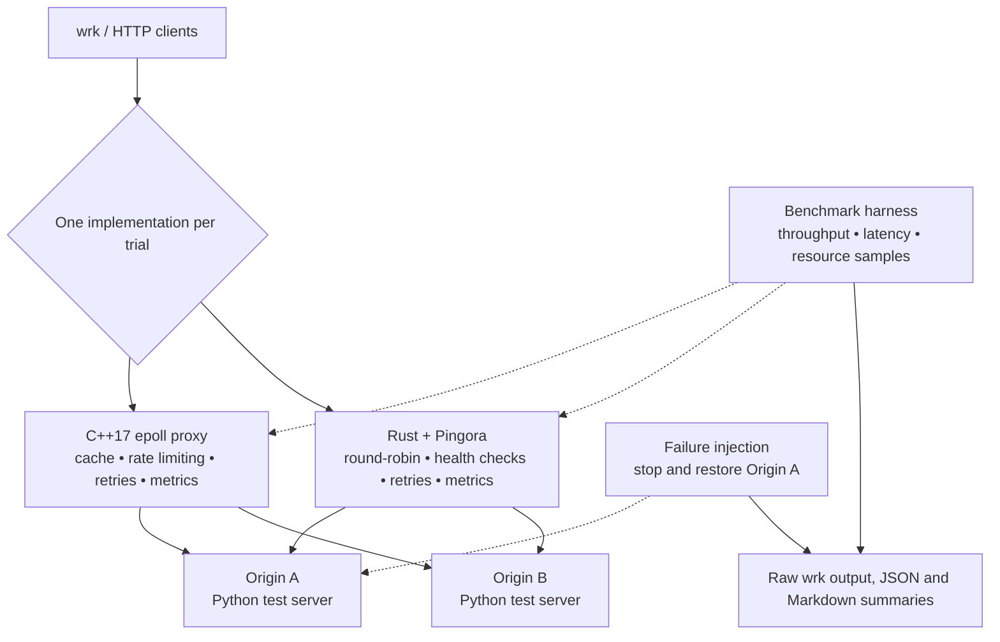

# EdgeGuard — architecture and test boundaries

This repository contains **two separate proxy implementations**, not a single proxy that runs C++ and Rust together. They are compared using shared synthetic origins and the same load generator.



## Components and differences

| Area | C++17 | Rust/Pingora |
|---|---|---|
| I/O | Linux `epoll` event loop | Pingora asynchronous runtime |
| HTTP | HTTP/1.1 | HTTP reverse proxy via Pingora |
| Backend selection | Round-robin / consistent hashing | Round-robin |
| Health monitoring | Active and passive checks | Background TCP health checks |
| Connection failure handling | Retry of eligible requests | Bounded connection retries of eligible GET/HEAD |
| Caching | LRU/TTL and coalescing | Not implemented in Rust prototype |
| Rate limiting | Per-client token bucket | Not implemented in Rust prototype |
| Observability | Prometheus-style metrics | Loopback-only Prometheus-style counters and latency buckets |
| Security hardening | Parser and timeout protections | Not a hardened public service |

**Do not assume functional parity.** The benchmarking harness disables C++ response caching and tests HTTP GET forwarding through the same origins; implementation details and thread models still differ.

## Reproduce

See [Rust prototype setup](../README.md) and [comparative benchmark protocol](../benchmarks/README.md).

From the repository root, build the C++ proxy in Release mode. From `pingora-rust/`, build the Rust proxy in Release mode. Run the harness from `pingora-rust/`:

```bash
python3 scripts/compare_proxies.py --duration 8 --connections 32 --threads 2 --repeat 3
python3 scripts/summarize_comparison.py benchmarks/results/<RUN_FOLDER>/results.json
```

The automated workflow runs this comparison and separate origin failure tests; see `/.github/workflows/pingora-rust.yml`.

## Engineering insights and limitations

- Shared GitHub runners and thread-per-connection Python origins can dominate p90/p99 latency.
- The first response from a recovered origin is an *observational* routing measurement, not precise internal health-check convergence.
- CPU sampling counts logical-core equivalents: 100% represents one fully utilized core.
- RSS is resident memory for the proxy PID, not the full test topology.
- The C++ and Pingora implementations differ in architecture and feature scope. Three short trials cannot determine a universal winner.
- All listeners default to loopback; this code is for local experimentation, not production Internet exposure.
